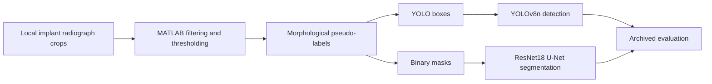
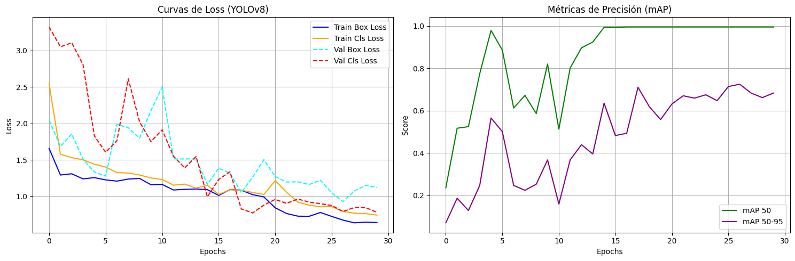
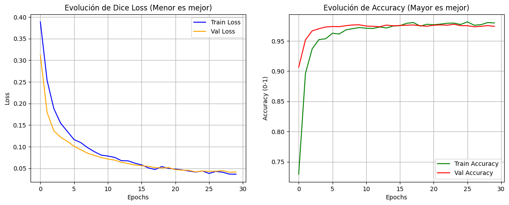

# Dental Implant Detection & Segmentation

**A hybrid computer-vision pipeline combining MATLAB image processing, YOLOv8n object detection and U-Net segmentation.**

University final project by **Joel Alfaro and Daniel Pastor**, developed at **Universitat Politècnica de Catalunya (UPC)**. It explores how classical image processing can create supervision for two complementary deep-learning tasks: locating an implant and estimating its pixel mask.

## Pipeline



1. **Prepare supervision.** Gaussian smoothing, contrast adjustment and Otsu thresholding isolate bright structures. A histogram-based fallback, hole filling, vertical morphological opening, largest-component selection and disk opening/closing refine the mask. MATLAB exports normalized YOLO boxes and binary segmentation masks.
2. **Detect the implant.** COCO-pretrained YOLOv8n is fine-tuned for one class at 640 pixels, batch size 8, for 30 epochs. Horizontal flips, rotations, scaling, brightness variation, mosaic and mixup augment training.
3. **Segment its shape.** U-Net uses an ImageNet-pretrained ResNet18 encoder at 256 × 256 pixels, binary Dice loss and Adam with a learning rate of 0.0001. Joint image/mask transformations preserve geometric alignment during 30 training epochs.
4. **Inspect learning and outputs.** The original notebook evaluates detection on the test split and segmentation using the final epoch-30 model, with learning curves and qualitative inspection functions.

## Recorded results

These are **archived academic outputs**, not a new benchmark run. Annotations were generated automatically by MATLAB; the scores measure agreement with those pseudo-labels.

| Model | Archived test result | Interpretation |
| --- | --- | --- |
| YOLOv8n | mAP50 **0.9950**; mAP50–95 **0.7701** | 35 test images and 35 implant instances in the saved run. |
| ResNet18 U-Net | Dice loss **0.0334**; pixel accuracy **98.13%** | Final epoch-30 model; equal averages over batches. Accuracy includes background. |

The minimum recorded U-Net validation loss was **0.0408 at epoch 29**. The original code did not save/select that checkpoint for testing. Foreground Dice, IoU, uncertainty intervals and clinical outcomes were not reported.





### What the evidence supports

The project demonstrates a complete workflow from classical pseudo-label generation to transfer learning for bounding-box detection and binary segmentation. It records both training behavior and held-out evaluation, while exposing the assumptions in its supervision.

There are material limits: the supplied dataset archive contains **138/33/29** train/validation/test images, whereas saved YOLO logs show **140/25/35**. The original MATLAB split was unseeded. The archive therefore cannot reproduce the stored split or results. A local audit found 200 unique image files, disjoint filenames between splits, paired nonempty masks of matching dimensions and valid normalized label fields. Those checks do not establish patient independence.

The thresholding method assumes a single bright, roughly vertical implant in each crop and can struggle with other bright structures. There are no expert-reviewed labels or clinical validation. This is an educational experiment, and the scores should not be interpreted as diagnostic performance.

## Run a new experiment

Python 3.12 is the recorded major/minor environment. A CUDA GPU is recommended for training; the notebook also selects CPU when CUDA is unavailable. MATLAB with Image Processing Toolbox is needed only to regenerate pseudo-labels.

```bash
python -m venv .venv
source .venv/bin/activate
python -m pip install -r requirements.txt
jupyter lab
```

Start Jupyter from the repository root and open `notebooks/implant_detection_segmentation.ipynb`. Provide authorized local data following [the data contract](data/README.md). Initial model loading downloads pretrained YOLO and ResNet18 weights. Run the cells in order to train both models, plot curves, evaluate and inspect local predictions. Generated runs and weights are ignored by Git.

Radiographs, derived image data and trained weights are not bundled: the supplied material did not establish data provenance or redistribution terms. The repository contains code and aggregate experiment evidence. The cleaned notebook uses Albumentations 2.x Gaussian-noise defaults because the original saved output rejected its `var_limit` parameter; new runs are not exact reproductions of that environment. See [provenance and edits](docs/provenance.md).

## Repository contents

| Path | Purpose |
| --- | --- |
| `matlab/build_implant_dataset.m` | Readable classical segmentation and annotation export. |
| `notebooks/implant_detection_segmentation.ipynb` | Two-task training, evaluation and local visualization workflow. |
| `results/` | Archived aggregate metrics, learning curves and U-Net history. |
| `data/README.md` | Expected data layout and annotation conventions. |
| `docs/provenance.md` | Source fingerprints, publication changes and evidence limits. |
| `docs/verification.md` | Checks actually performed for this edition. |

## Credits

**Joel Alfaro and Daniel Pastor — university team project, UPC.** Models use Ultralytics YOLO and Segmentation Models PyTorch with public pretrained backbones. The MATLAB and Python workflow is preserved as an academic project snapshot. Third-party packages and pretrained weights retain their own terms; no new project license is asserted.
